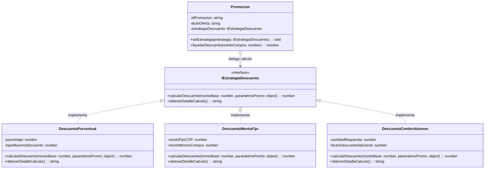
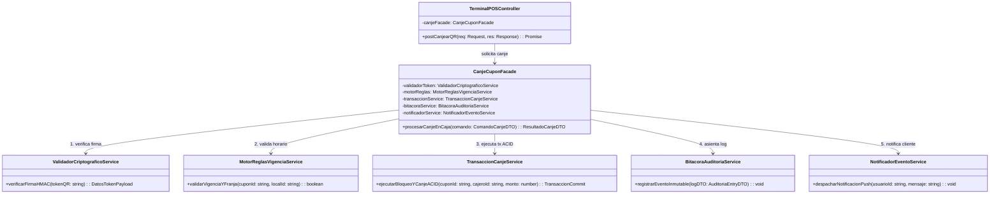

# Especificación de Patrones de Diseño GoF Aplicados (A3)
## Proyecto Formativo: Nuvora — Plataforma Transaccional Gastronómica
**Programa:** Análisis y Desarrollo de Software (ADSO) · Ficha 3413974  
**Centro:** Centro de la Industria, la Empresa y los Servicios (CIES) — Regional Huila  
**Aprendiz Autor:** Jose Esneider Covaleda Hortua (`covaleda402`)  
**Fase:** 02 - Planeación | **Competencia:** 220501095 | **RAP:** 593103 (Criterio C3)  
**Ruta:** `02-training-project/01-phase/02-planning/06-architecture/04-evidence-learning/G2-P1-covaleda/`  
**Normativa:** `Rubricas_G2.md` (Sección 2.1 y Sección 2.2 · Nivel 100)

---

## 1. Introducción y Criterios de Selección

Para dar estricto cumplimiento al **Criterio C3 de la Rúbrica G2-P1**, se incorporan dos (2) patrones de diseño de la banda de los cuatro (*Gang of Four - GoF*), ambos **diferentes del patrón Singleton**, orientados a resolver problemáticas reales de alta criticidad en la plataforma **Nuvora**:

1. **Patrón de Comportamiento: Strategy (Estrategia):** Para la parametrización dinámica y el cálculo polimórfico de las modalidades de descuento aplicadas a los cupones.
2. **Patrón Estructural: Facade (Fachada):** Para la orquestación unificada y el desacoplamiento del flujo transaccional de validación, bloqueo concurrente y canje en la terminal POS de caja.

Ambos patrones se encuentran reflejados e integrados formalmente en el **Diagrama de Clases de Diseño (`02-diagrama-clases.drawio` / `.svg`)**.

---

## 2. Patrón 1: Strategy (Estrategia) — Cálculo Polimórfico de Descuentos

### 2.1 Problema Concreto del Caso de Estudio
Los locales gastronómicos de la plazoleta del Centro Comercial San Pedro Plaza manejan modelos comerciales dispares para sus ofertas:
* Comercios de comida rápida aplican **descuentos porcentuales** directos sobre el plato (ej. 20% en combos de hamburguesa).
* Restaurantes tradicionales aplican **descuentos por monto fijo en COP** (ej. rebaja de \$5.000 COP en compras superiores a \$25.000 COP).
* Locales de postres y bebidas manejan **promociones por combo de volumen** (ej. pague 2 y lleve el 3º a mitad de precio o combo 2 postres por \$17.000 COP).

Si el software calcula estos montos mediante estructuras condicionales anidadas (`if-else` o `switch`) dentro de la clase `Promocion` o `Cupon`, cada vez que la administración apruebe un nuevo tipo de campaña comercial se tendría que modificar el código fuente de las clases centrales de negocio. Esto violaría directamente el **Principio de Abierto/Cerrado (Open/Closed Principle - OCP)** y generaría un alto riesgo de regresiones en las promociones que ya están operando en vivo.

### 2.2 Por Qué se Elige este Patrón
El patrón **Strategy** desacopla la familia de algoritmos de cálculo de descuento de la entidad que los utiliza. Define una interfaz común (`IEstrategiaDescuento`) y sitúa cada algoritmo concreto en su propia clase encapsulada. La clase `Promocion` mantiene una referencia polimórfica a la interfaz, delegándole la ejecución del cálculo monetario en tiempo de ejecución sin conocer los detalles algorítmicos internos.

### 2.3 Clases que lo Implementan en el Diagrama

* **Interfaz:** `IEstrategiaDescuento` (declara el contrato formal de liquidación monetaria).
* **Estrategias Concretas (Polimorfismo con 3 implementaciones):**
  1. `DescuentoPorcentual`: Aplica el porcentaje pactado validando que no supere un tope máximo parametrizado.
  2. `DescuentoMontoFijo`: Resta el valor nominal fijo siempre que la compra supere el umbral mínimo establecido.
  3. `DescuentoComboVolumen`: Calcula la tarifa diferencial para compras agrupadas o promociones tipo combo.
* **Contexto:** `Promocion` (contiene la estrategia activa y delega el método `liquidarDescuento()`).

### 2.4 Qué Mejora en Mantenibilidad y Calidad de Software
1. **Extensibilidad sin Modificación (OCP):** Si mañana un locatario crea un descuento por convenio bancario (ej. "15% pagando con Tarjeta Davivienda"), se crea una clase `DescuentoConvenioBancario` que implementa `IEstrategiaDescuento`, sin tocar la clase `Promocion` ni `Cupon`.
2. **Alta Cohesión y Responsabilidad Única (SRP):** Cada regla de cálculo matemático vive aislada en su propia clase, haciendo trivial la escritura de pruebas unitarias automatizadas con cobertura del 100%.
3. **Eliminación de Sentencias Condicionales:** Se eliminan los `switch(tipoPromo)` propensos a errores humanos de tipografía o casos por defecto olvidados.

---

## 3. Patrón 2: Facade (Fachada) — Orquestación del Canje Transaccional POS

### 3.1 Problema Concreto del Caso de Estudio
El proceso de canje de un cupón en la terminal de punto de venta en caja (`CU-07`) es el momento transaccional más sensible y de mayor estrés operativo del sistema. Cuando el cajero escanea el código QR del visitante, deben ejecutarse secuencialmente múltiples operaciones coordinadas entre subsistemas heterogéneos:
1. Validar la firma criptográfica del token QR con clave secreta HMAC-SHA256 para evitar suplantaciones o inyecciones maliciosas.
2. Consultar el estado del cupón y validar que la hora del sistema no exceda la ventana de vigencia de 2 horas.
3. Verificar que la promoción aplique al local comercial del cajero y que la compra esté dentro de la franja horaria autorizada.
4. Iniciar una transacción atómica ACID en la base de datos PostgreSQL, ejecutando un bloqueo pesimista a nivel de fila (`SELECT ... FOR UPDATE`) para impedir condiciones de carrera por intentos de canje simultáneos.
5. Transicionar el estado del cupón a `Canjeado`, decrementar el stock disponible de la promoción y generar el registro inmutable en la bitácora de auditoría transaccional.
6. Emitir un evento asíncrono para notificar al visitante en su PWA que el cupón fue redimido con éxito.

Si la capa de presentación (el controlador web de la caja `TerminalPOSController`) interactuara directamente con los 5 servicios y repositorios especializados, se generaría un **acoplamiento inmanejable** (*Spaghetti Architecture*). Cualquier refactorización interna en la base de datos o en el protocolo de notificación obligaría a reescribir la lógica de la interfaz de usuario en caja.

### 3.2 Por Qué se Elige este Patrón
El patrón **Facade** proporciona una interfaz unificada, simple y de alto nivel que oculta toda la complejidad del subsistema transaccional. La clase `CanjeCuponFacade` actúa como único punto de entrada para los clientes de caja, orquestando las dependencias internas y exponiendo un único método de negocio limpio: `procesarCanjeEnCaja(comandoCanje)`.

### 3.3 Clases que lo Implementan en el Diagrama

* **Cliente de la Fachada:** `TerminalPOSController` (recibe la petición HTTP del escáner en caja y consume la fachada).
* **Fachada:** `CanjeCuponFacade` (orquesta el ciclo completo, maneja transacciones y rollbacks).
* **Subsistemas Ocultos:**
  1. `ValidadorCriptograficoService`: Desencripta y valida la firma digital del token QR.
  2. `MotorReglasVigenciaService`: Verifica expiración temporal y compatibilidad de franja horaria.
  3. `TransaccionCanjeService`: Gestiona la conexión JDBC/PostgreSQL y el bloqueo de fila.
  4. `BitacoraAuditoriaService`: Persiste el registro inmutable de auditoría para trazabilidad.
  5. `NotificadorEventoService`: Envía notificaciones WebSocket / Push al cliente.

### 3.4 Qué Mejora en Mantenibilidad y Calidad de Software
1. **Bajo Acoplamiento (*Loose Coupling*):** La interfaz de caja solo conoce un método de la fachada; desconoce por completo la tecnología de base de datos o las librerías criptográficas utilizadas tras bambalinas.
2. **Facilidad de Pruebas de Integración:** La fachada se puede mockear fácilmente en pruebas de integración de la interfaz de caja, o probarse de forma aislada para certificar que el rollback transaccional se ejecute si la firma o el horario fallan.
3. **Consistencia Transaccional Centralizada:** Al existir un único punto de entrada para canjear cupones, se garantiza que **ningún programador pueda saltarse la validación de la bitácora o el bloqueo pesimista**, protegiendo la integridad financiera de los comerciantes.

---

## 4. Cuadro Comparativo de los Patrones Aplicados

| Aspecto de Evaluación | Patrón GoF 1: Strategy (Estrategia) | Patrón GoF 2: Facade (Fachada) |
|---|---|---|
| **Tipo de Patrón GoF** | Comportamiento | Estructural |
| **Problema que Resuelve** | Multiplicidad de algoritmos de descuento que cambian según la campaña comercial. | Alta complejidad y acoplamiento en la orquestación del canje transaccional en punto de venta. |
| **Elemento Clave de Diseño** | Interfaz polimórfica `IEstrategiaDescuento` con 3 clases concretas intercambiables. | Clase unificada `CanjeCuponFacade` que encapsula 5 subsistemas de validación y persistencia. |
| **Principio SOLID Reforzado** | **Open/Closed Principle (OCP)** e **Interface Segregation (ISP)**. | **Single Responsibility (SRP)** y **Dependency Inversion (DIP)**. |
| **Impacto Directo en Calidad** | Adición de nuevas promociones sin riesgo de romper código en producción. | Transacciones atómicas seguras sin acoplar la terminal física de caja con la base de datos. |
