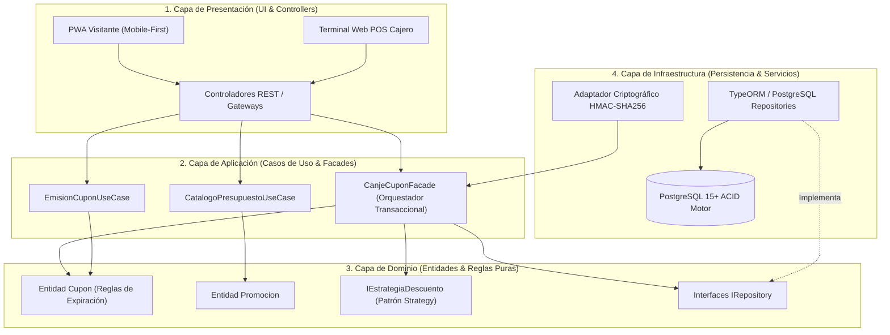

# Arquitectura del Software y Decisiones Frente a RNF (A4)
## Proyecto Formativo: Nuvora — Plataforma Transaccional Gastronómica
**Programa:** Análisis y Desarrollo de Software (ADSO) · Ficha 3413974  
**Centro:** Centro de la Industria, la Empresa y los Servicios (CIES) — Regional Huila  
**Aprendiz Autor:** Jose Esneider Covaleda Hortua (`covaleda402`)  
**Fase:** 02 - Planeación | **Competencia:** 220501095 | **RAP:** 593103 (Criterio C4)  
**Ruta:** `02-training-project/01-phase/02-planning/06-architecture/04-evidence-learning/G2-P1-covaleda/`  
**Normativa:** `Rubricas_G2.md` (Sección 2.1 y Sección 2.2 · Nivel 100)

---

## 1. Definición del Estilo Arquitectónico: Arquitectura en Capas Limpia (*Clean Layered Architecture*)

Para garantizar el cumplimiento de los principios de alta cohesión, bajo acoplamiento y mantenibilidad a largo plazo, la plataforma **Nuvora** adopta el estilo arquitectónico de **Capas Estrictas y Desacopladas (*Clean Layered Architecture*)**, organizado en cuatro (4) niveles jerárquicos:

1. **Capa de Presentación / Cliente (UI / API Gateway):**
   * Aplicación Web Progresiva (*PWA*) para visitantes y terminal web de punto de venta (*POS*) para cajeros locatarios.
   * Controladores HTTP REST y puertas de enlace (*Gateways*) encargados de la validación inicial de sintaxis DTO y deserialización.
2. **Capa de Aplicación y Casos de Uso (Lógica de Aplicación):**
   * Orquestadores de casos de uso (ej. `CanjeCuponFacade`, `EmisionCuponService`, `CatalogoPresupuestoService`).
   * No contiene reglas intrínsecas de entidades ni llamadas SQL directas; coordina los flujos entre dominio y servicios externos.
3. **Capa de Dominio (Lógica de Negocio Pura):**
   * Entidades de negocio (`Usuario`, `Comercio`, `Promocion`, `Cupon`, `BitacoraCanje`).
   * Interfaces de repositorios (`ICuponRepository`, `IComercioRepository`) y contratos de patrones GoF (`IEstrategiaDescuento`).
   * Es el núcleo del sistema y **no tiene dependencias hacia ninguna tecnología o librería externa** (*Dependency Inversion Principle*).
4. **Capa de Infraestructura y Persistencia (Datos y Servicios Externos):**
   * Implementaciones concretas de repositorios mediante ORM / TypeORM y conectores PostgreSQL.
   * Adaptadores para firma criptográfica HMAC-SHA256, motor de caché Redis y despachador de WebSockets.

### 1.1 Regla de Oro: Prohibición de Saltos de Capa
La arquitectura impone una **comunicación unidireccional descendente estricta**:
$$\text{Presentación} \longrightarrow \text{Aplicación} \longrightarrow \text{Dominio} \longleftarrow \text{Infraestructura (mediante inversión de dependencias)}$$
* **Regla estricta:** La capa de presentación tiene **terminantemente prohibido saltar la capa de aplicación o consultar directamente la infraestructura de base de datos**. Toda consulta o comando debe transitar por los servicios autorizados.

---

## 2. Tabla de Decisiones de Arquitectura Frente a Requisitos No Funcionales (RNF)

| ID RNF | Requisito No Funcional (Métrica) | Decisión de Diseño Arquitectónico Implementada | Alternativa Descartada | Razón Concreta del Descarte |
|:---:|---|---|---|---|
| **RNF-01** | **Rendimiento:** Validación y canje en caja en tiempo $\le 1.5$ s con hasta 150 tx/min. | **Caché en memoria (Redis) para catálogo y franjas horarias + Bloqueo atómico a nivel de fila (`SELECT ... FOR UPDATE`) en PostgreSQL.** Los locales y menús se leen de caché ultrarrápida; solo la transacción de canje escribe en disco con índice B-Tree sobre el código de cupón. | Consultar la base de datos relacional en cada petición HTTP sin capa de caché, recalculando menús en tiempo real. | Bajo horas pico de almuerzo (12:30 a 1:45 p. m.), las consultas repetitivas de 12.000 visitantes colapsarían el *pool* de conexiones del motor relacional, elevando la latencia por encima de 4.0 segundos. |
| **RNF-02** | **Seguridad y Criptografía:** Protección contra falsificación de cupones y fuga de credenciales. | **Sellado criptográfico de token QR con HMAC-SHA256 + Contraseñas con dispersión bcrypt (costo 12) + Tráfico forzado sobre TLS 1.3.** El QR contiene payload firmado con marca temporal efímera (2h). La clave secreta nunca viaja al cliente. | Generar un código QR estático con el ID primario secuencial (`id_cupon = 1042`) almacenado en texto plano. | Vulnerabilidad crítica de enumeración y falsificación: cualquier usuario podría generar QRs falsos cambiando el número o reutilizar capturas de pantalla de WhatsApp para reclamar descuentos ajenos. |
| **RNF-03** | **Disponibilidad y Concurrencia:** $\ge 99.5\%$ de disponibilidad y aislamiento transaccional total. | **Transacciones con aislamiento *Read Committed* y bloqueo pesimista de fila en motor relacional.** Al momento de validar, el cupón se bloquea en BD durante los 50 ms de verificación y pasa a `CANJEADO`, impidiendo lecturas sucias o sobrecanjes. | Arquitectura basada en consistencia eventual (*Eventual Consistency*) sobre base de datos NoSQL documental (MongoDB). | La consistencia eventual presenta ventanas de sincronización de varios segundos donde un mismo cupón puede ser canjeado concurrentemente en dos cajas distintas antes de propagarse el cambio, causando pérdidas financieras al comercio. |
| **RNF-04** | **Usabilidad y Continuidad:** Operatividad con fallas de hardware óptico o baja señal Wi-Fi. | **Mecanismo de contingencia dual en caja (escáner óptico POS o digitación de código alfanumérico corto de 8 caracteres `NUV-XXXX`) + PWA con Service Worker.** Si la cámara o el escáner fallan, el cajero digita el código corto que valida con el mismo backend. | Exigir escaneo óptico obligatorio por hardware propietario conectado a puerto COM/USB sin interfaz manual alternativa. | Si la pantalla del celular del cliente está rota, rayada o con brillo deficiente, o si el escáner se daña, el cajero quedaría bloqueado, generando filas en caja y cancelaciones de compra. |

---

## 3. Estilo de Comunicación entre Componentes

1. **Comunicación Externa (Cliente $\longleftrightarrow$ Backend):**
   * **Protocolo:** **HTTPS (puerto 443) sobre TLS 1.3**.
   * **Formato de Carga:** Payloads estructurados en **JSON (*JavaScript Object Notation*)**, validados en los controladores mediante *Pipes* de validación estricta (evitando inyecciones y *over-posting*).
   * **Autenticación en Tránsito:** Cabecera estándar HTTP `Authorization: Bearer <Token_JWT>`, validada en un *Guard* de autenticación previo al ingreso a la capa de aplicación.
2. **Comunicación en Tiempo Real (Notificaciones de Canje):**
   * **Protocolo:** **WebSockets protegidos (WSS)** para transmitir el evento instantáneo de «Cupón Canjeado» desde el backend hacia la pantalla del cliente que está esperando en la fila, desactivando el reloj regresivo en su billetera móvil.
3. **Comunicación Interna entre Módulos (En el proceso del servidor):**
   * Inyección de Dependencias (*Dependency Injection*) nativa mediante interfaces desacopladas, lo que permite intercambiar proveedores de servicios o crear *mocks* para pruebas unitarias sin impacto en el código de producción.
