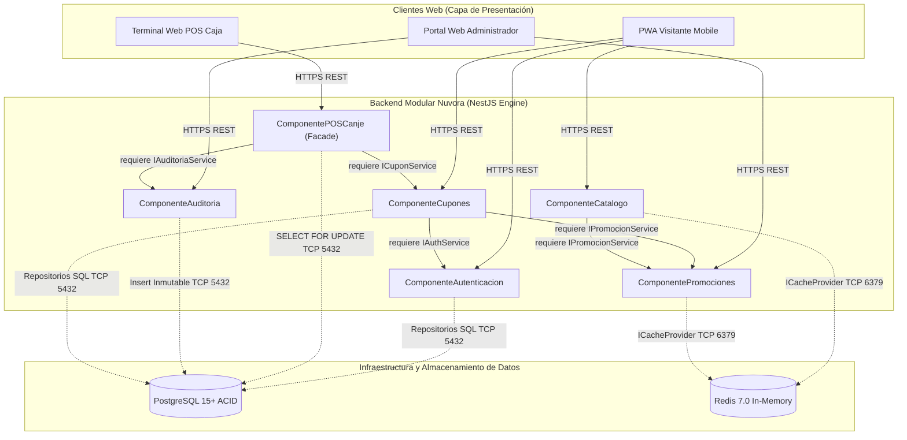

# Vista de Componentes del Software (A5)
## Proyecto Formativo: Nuvora — Plataforma Transaccional Gastronómica
**Programa:** Análisis y Desarrollo de Software (ADSO) · Ficha 3413974  
**Centro:** Centro de la Industria, la Empresa y los Servicios (CIES) — Regional Huila  
**Aprendiz Autor:** `covaleda402`  
**Fase:** 02 - Planeación | **Competencia:** 220501095 | **RAP:** 593103 (Criterio C5)  
**Ruta:** `02-training-project/01-phase/02-planning/06-architecture/04-evidence-learning/G2-P1-covaleda/`  
**Normativa:** `Rubricas_G2.md` (Sección 2.1 y Sección 2.2 · Nivel 100) y `Plantillas_G2.md`

---

## 1. Introducción y Propósito de la Vista de Componentes

La Vista de Componentes modela la organización modular y las dependencias en tiempo de compilación/ejecución de **Nuvora**. Define los contratos explícitos de comunicación entre módulos mediante **interfaces provistas** (servicios expuestos) e **interfaces requeridas** (dependencias consumidas por inversión de dependencias), garantizando alta cohesión y bajo acoplamiento.

El diagrama oficial en formato editable y vectorial sin solapamientos se encuentra en:
* **Imagen Vectorial:** [`05-vista-componentes.svg`](./05-vista-componentes.svg)
* **Fuente Editable Draw.io:** [`05-vista-componentes.drawio`](./05-vista-componentes.drawio)

---

## 2. Diagrama de Componentes (Esquema de Flujo y Dependencias)

---

## 3. Matriz de Componentes, Interfaces y Mapeo de Clases (Criterio C5)

Se especifican los **seis (6) componentes de software** del sistema ($\ge 5$ exigidos), con sus interfaces provistas, requeridas, clases del Diagrama de Clases (`02-diagrama-clases.drawio`) y servicios que agrupa, y requisitos atendidos:

| # | Componente | Interfaz que Provee (Contrato Expuesto) | Interfaz que Requiere (Dependencia Externa) | Clases que Agrupa (Diseño + Apoyo) | Requisitos Atendidos |
|:---:|---|---|---|---|---|
| **1** | **ComponenteAutenticacion** (`AuthModule`) | `IAuthService` `ITokenVerifier` | `IUsuarioRepository` `IHashingService` | `Usuario`, `Visitante`, `Locatario`, `AuthService`, `RoleGuard` | **RF-01, RF-02, RF-03, RNF-02, RNF-09** |
| **2** | **ComponenteCatalogo** (`CatalogModule`) | `ICatalogoService` `IBuscadorPresupuesto` | `IComercioRepository` `IPromocionService` `ICacheProvider` | `Comercio`, `MenuProducto`, `CatalogoService`, `BuscadorPresupuesto` | **RF-04, RF-05, RF-06, RF-07, RF-08, RNF-01, RNF-05** |
| **3** | **ComponentePromociones** (`PromotionModule`) | `IPromocionService` `IFranjaValidator` | `IPromocionRepository` `IEstrategiaDescuento` `ICacheProvider` | `Promocion`, `FranjaHoraria`, `IEstrategiaDescuento`, `DescuentoPorcentual`, `DescuentoMontoFijo`, `DescuentoComboVolumen` | **RF-09, RF-10, RF-11, RF-12, RNF-01** |
| **4** | **ComponenteCupones** (`CouponModule`) | `ICuponService` `ICuponLifecycle` | `ICuponRepository` `IPromocionService` `IAuthService` | `Cupon`, `GeneradorTokenQRService`, `CuponLifecycleWorker` | **RF-13, RF-14, RF-15, RNF-03** |
| **5** | **ComponentePOSCanje** (`POSRedemptionModule`) | `IPOSCanjeService` `IContingenciaScanner` | `ICuponService` `IAuditoriaService` `ITransaccionManager` | `CanjeCuponFacade`, `TerminalPOSController`, `TransaccionCanjeService`, `ValidadorTokenService` | **RF-16, RF-17, RF-18, RNF-01, RNF-04, RNF-08** |
| **6** | **ComponenteAuditoria** (`AuditModule`) | `IAuditoriaService` `IAnaliticaReportService` | `IBitacoraRepository` `IReporteRepository` | `BitacoraCanje`, `ReporteComercial`, `BitacoraAuditoriaService` | **RF-19, RF-20, RNF-02** |

---

## 4. Análisis de Acoplamiento, Cohesión y Regla de Capas

1. **Cero Saltos de Capa:** Los componentes de presentación (`PWA Visitante Mobile`, `Terminal Web POS Caja`, `Portal Web Administrador`) consumen exclusivamente endpoints REST del Backend Modular; nunca acceden directamente a PostgreSQL ni a Redis.
2. **Separación de Reportes y Persistencia:** La generación de métricas e informes (`RF-19`) se encapsula en `ReporteComercial` dentro de `ComponenteAuditoria`, evitando sobrecargar la clase `Locatario` con lógica de reportería; asimismo, las entidades de dominio (`Cupon`, `BitacoraCanje`) no contienen lógica de acceso directo a BD.
3. **Bajo Acoplamiento por Contratos:** Cada dependencia entre componentes (`ICuponService`, `IAuditoriaService`, `IPromocionService`, `IAuthService`) apunta estrictamente hacia interfaces abstractas, permitiendo evolucionar algoritmos o escribir pruebas unitarias aisladas con *mocks*.
