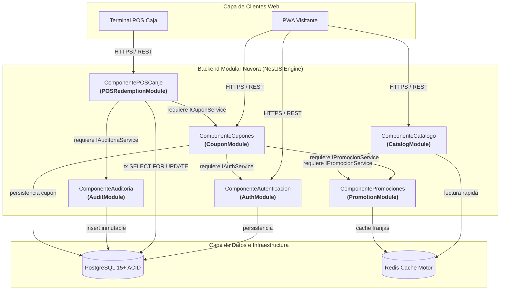

# Vista de Componentes del Software (A5)
## Proyecto Formativo: Nuvora — Plataforma Transaccional Gastronómica
**Programa:** Análisis y Desarrollo de Software (ADSO) · Ficha 3413974  
**Centro:** Centro de la Industria, la Empresa y los Servicios (CIES) — Regional Huila  
**Aprendiz Autor:** Jose Esneider Covaleda Hortua (`covaleda402`)  
**Fase:** 02 - Planeación | **Competencia:** 220501095 | **RAP:** 593103 (Criterio C5)  
**Ruta:** `02-training-project/01-phase/02-planning/06-architecture/04-evidence-learning/G2-P1-covaleda/`  
**Normativa:** `Rubricas_G2.md` (Sección 2.1 y Sección 2.2 · Nivel 100)

---

## 1. Introducción y Propósito de la Vista de Componentes

La Vista de Componentes modela la organización y dependencias entre los módulos de software ejecutables que componen el backend de **Nuvora**. Define claramente los contratos de comunicación mediante **interfaces provistas (lo que el componente expone al sistema)** e **interfaces requeridas (los servicios que necesita de otros componentes para operar)**, asegurando un diseño modular de alta cohesión y bajo acoplamiento.

El diagrama formal se encuentra disponible en formato vectorial e hipervínculo editable:
* **Vector de alta resolución:** [`05-vista-componentes.svg`](./05-vista-componentes.svg)
* **Fuente editable Draw.io:** [`05-vista-componentes.drawio`](./05-vista-componentes.drawio)

---

## 2. Diagrama de Componentes (Esquema de Flujo y Dependencias)

---

## 3. Matriz de Componentes, Interfaces y Mapeo de Clases

Para dar cumplimiento exhaustivo a la Rúbrica G2-P1 (Criterio C5), a continuación se detallan los **seis (6) componentes de software** diseñados, especificando sus interfaces provistas y requeridas, las clases que agrupa cada uno y los requisitos funcionales/no funcionales que atiende:

| # | Componente | Interfaz que Provee (Contrato Expuesto) | Interfaz que Requiere (Dependencia Externa) | Clases de Diseño que Agrupa | Requisitos Atendidos |
|:---:|---|---|---|---|:---:|
| **1** | **ComponenteAutenticacion** (`AuthModule`) | `IAuthService` `ITokenVerifier` | `IUsuarioRepository` `IHashingService` | `UsuarioController`, `AuthService`, `JwtStrategy`, `BcryptHasher`, `RoleGuard` | **RF-01, RF-02, RF-03, RNF-02** |
| **2** | **ComponenteCatalogo** (`CatalogModule`) | `ICatalogoService` `IBuscadorPresupuesto` | `IComercioRepository` `IMenuItemRepository` `ICacheProvider` | `CatalogoController`, `CatalogoService`, `MotorPresupuestoAlgorithm`, `ComercioMapper` | **RF-04, RF-05, RF-06, RF-07, RF-08, RNF-01** |
| **3** | **ComponentePromociones** (`PromotionModule`) | `IPromocionService` `IFranjaValidator` | `IPromocionRepository` `IEstrategiaDescuento` `ICacheProvider` | `PromocionController`, `PromocionService`, `ValidadorFranjaHoraria`, `DescuentoPorcentual`, `DescuentoMontoFijo`, `DescuentoComboVolumen` | **RF-09, RF-10, RF-11, RF-12, RNF-01** |
| **4** | **ComponenteCupones** (`CouponModule`) | `ICuponService` `ICuponLifecycle` | `ICuponRepository` `IPromocionService` `IAuthService` `ICriptoSigner` | `CuponController`, `EmisionCuponService`, `HMACSHA256Signer`, `CuponLifecycleWorker`, `CuponEntity` | **RF-13, RF-14, RF-15, RNF-02, RNF-03** |
| **5** | **ComponentePOSCanje** (`POSRedemptionModule`) | `IPOSCanjeService` `IContingenciaScanner` | `ICuponService` `IAuditoriaService` `ITransaccionManager` | `TerminalPOSController`, `CanjeCuponFacade`, `TransaccionCanjeService`, `ValidadorCajeroContext`, `RollbackHandler` | **RF-16, RF-17, RNF-01, RNF-03, RNF-04** |
| **6** | **ComponenteAuditoria** (`AuditModule`) | `IAuditoriaService` `IAnaliticaReportService` | `IBitacoraRepository` `IDataExportProvider` | `BitacoraAuditoriaService`, `MetricasAgregadasService`, `AuditoriaController`, `BitacoraCanjeEntity` | **RF-18, RF-19, RF-20, RNF-02** |

---

## 4. Análisis de Acoplamiento y Cohesión

1. **Alta Cohesión Modular:** Cada componente agrupa exclusivamente las responsabilidades de su área de negocio. `ComponentePOSCanje` no calcula descuentos (delega a `ComponentePromociones`) ni almacena usuarios (delega a `ComponenteAutenticacion`).
2. **Bajo Acoplamiento por Inversión de Dependencias (DIP):** Ningún componente depende de las implementaciones concretas de otros componentes; todas las dependencias se inyectan a través de interfaces (`IPromocionService`, `IAuditoriaService`), permitiendo cambiar motores o mockear servicios en pruebas unitarias con facilidad.
