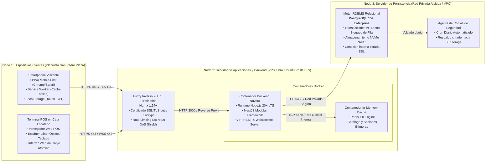

# Vista de Despliegue del Sistema (A6)
## Proyecto Formativo: Nuvora — Plataforma Transaccional Gastronómica
**Programa:** Análisis y Desarrollo de Software (ADSO) · Ficha 3413974  
**Centro:** Centro de la Industria, la Empresa y los Servicios (CIES) — Regional Huila  
**Aprendiz Autor:** Jose Esneider Covaleda Hortua (`covaleda402`)  
**Fase:** 02 - Planeación | **Competencia:** 220501095 | **RAP:** 593103 (Criterio C6)  
**Ruta:** `02-training-project/01-phase/02-planning/06-architecture/04-evidence-learning/G2-P1-covaleda/`  
**Normativa:** `Rubricas_G2.md` (Sección 2.1 y Sección 2.2 · Nivel 100)

---

## 1. Introducción y Topología de Despliegue

La Vista de Despliegue modela la asignación física de los artefactos de software a los nodos de cómputo e infraestructura de red donde opera **Nuvora**. Define los protocolos de comunicación, los puertos de red asignados, los límites de seguridad perimetral y las decisiones de arquitectura que responden directamente a los **Requisitos No Funcionales (RNF)** de rendimiento, seguridad y disponibilidad.

Los diagramas correspondientes se encuentran disponibles en:
* **Vector de alta resolución:** [`06-vista-despliegue.svg`](./06-vista-despliegue.svg)
* **Fuente editable Draw.io:** [`06-vista-despliegue.drawio`](./06-vista-despliegue.drawio)

---

## 2. Diagrama de Despliegue Físico y de Red

---

## 3. Matriz de Nodos, Artefactos y Protocolos de Comunicación

| Nodo Físico / Lógico | Artefactos que Aloja | Conexión (Protocolo y Puerto) | Decisión Arquitectónica que Responde a un RNF |
|---|---|---|---|
| **Nodo 1: Dispositivos Clientes** *(Smartphones de Visitantes y Terminales POS de Locatarios)* | • Aplicación Web Progresiva (*PWA*) para visitantes. • Terminal Web de Caja para Cajeros. • *Service Worker* para caching estático y visualización offline básica. • Módulo de captura óptica para lector de código QR o digitación manual. | **HTTPS (puerto 443)** hacia el Nodo de Aplicación. **WSS (puerto 443)** para eventos push en tiempo real. | **RNF-04 (Usabilidad y Accesibilidad):** Interfaz ligera *Mobile-First* operable a una mano sin necesidad de instalar apps pesadas de tiendas comerciales; opera fluidamente bajo cobertura Wi-Fi irregular de la plazoleta. |
| **Nodo 2: Servidor de Aplicación y Backend** *(VPS Linux Ubuntu 22.04 LTS · 4 vCPU, 8 GB RAM)* | • Proxy inverso Nginx con terminación SSL/TLS. • Contenedor Docker con Backend NestJS / Node.js. • Contenedor Docker con motor de caché Redis 7.0. • Módulo Criptográfico HMAC-SHA256 para firma de cupones. • *Worker* cron para transicionar cupones vencidos cada 60 s. | **TCP 5432** hacia el Nodo de Datos (a través de red interna privada). **TCP 6379** interno en red virtual Docker hacia Redis. | **RNF-01 (Rendimiento $\le 1.5$ s) y RNF-02 (Seguridad):** El motor Redis en el mismo host reduce a $< 5$ ms la consulta del catálogo y menús para los 12.000 visitantes de fin de semana; Nginx aplica *Rate Limiting* (30 req/s) mitigando ataques DoS. |
| **Nodo 3: Servidor de Datos y Persistencia** *(Servidor Aislado en VPC · Almacenamiento SSD NVMe)* | • Motor Relacional PostgreSQL 15+. • Esquema relacional normalizado en 3FN con claves foráneas e índices B-Tree. • Bitácora inmutable de auditoría de canjes. • Servicio cron de copias de seguridad automáticas diarias. | **Cero exposición a internet público.** Solo acepta conexiones por **TCP 5432** originadas desde la IP privada del Nodo 2, autenticadas por certificado SSL y credenciales seguras. | **RNF-03 (Disponibilidad $\ge 99.5\%$ y Concurrencia ACID) y RNF-02 (Seguridad):** Aislamiento de red estricto (VPC con firewall UFW). Las transacciones atómicas con bloqueo pesimista garantizan cero sobrecanjes o inconsistencias financieras entre comercios. |

---

## 4. Estrategia de Continuidad del Servicio y Respaldo de Datos

1. **Alta Disponibilidad Operativa:** En caso de caída del contenedor de backend, el demonio Docker reinicia automáticamente el servicio (`restart: always`) en menos de 3 segundos.
2. **Política de Respaldos (Disponibilidad y Recuperación ante Desastres):**
   * Copias de seguridad completas automatizadas ejecutadas diariamente a las 3:00 a. m. (hora valle de actividad comercial).
   * Almacenamiento de respaldos en repositorio secundario cifrado con retención rotativa de 30 días calendario.
   * Protocolo de prueba de restauración mensual verificado en ambiente de preproducción con emisión de acta técnica.
